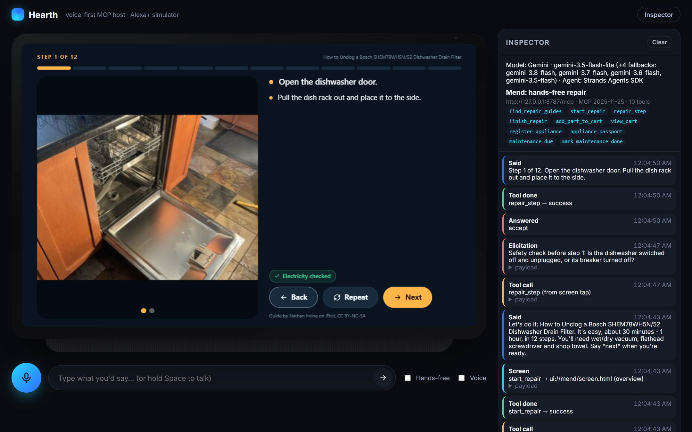

# Hearth: a voice-first MCP host that simulates Alexa+ on an Echo Show

There's no public way to try an MCP server the way **Alexa+** will use it:
- everything spoken aloud
- a smart-display screen next to the voice
- questions from the server answered by voice in the middle of a task

**Hearth** fills that gap. Point it at any Streamable HTTP MCP server and talk to it. It shows the server's **MCP Apps** screens on a simulated Echo Show and lets the person answer its **elicitations** by voice or touch, while the **Inspector** shows every MCP message.

It's free, open source (MIT) and needs no hardware. The agent runs on AWS's open-source **[Strands Agents SDK](https://github.com/strands-agents)** with a model you choose. The default is Google Gemini's free tier.



## Features

- **Voice in, voice out.** Push-to-talk (button or hold Space) or type. Replies are spoken with on-screen captions and an Alexa-style light bar for listening, thinking and speaking. Hands-free mode keeps the conversation going.
- **Any MCP server, spec 2025-11-25.** List servers in `hearth.config.json` with optional headers. Each device session opens its own MCP sessions over Streamable HTTP.
- **A real MCP Apps host.** It's built on the official `@modelcontextprotocol/ext-apps` **AppBridge**:
  - screens run in sandboxed iframes
  - the **server-declared CSP** is enforced (`resourceDomains`, `connectDomains`, `frameDomains`)
  - touches on the screen call tools through the host
  - `updateModelContext` keeps the voice agent aware of what was tapped
  - links open in a new tab
  - a refreshed page replays the session's screens
- **Elicitation by voice.** Form and URL modes. Yes/no questions are spoken and answered with "yes", "no" or "not yet". Other schemas render as a form. Answers go straight from the person to the server and never through the model.
- **Inspector.** A live timeline of what was heard and said, tool calls (from the assistant, a screen tap or a developer), results, elicitations and screens, with payloads.
- **No-model developer mode.** `/tool <name> {json}` calls a tool directly and renders its screen, so you can work on an MCP App without any AI model or key.
- **Pluggable models.**
  - Gemini (free key). Hearth probes the newest stable Flash models at startup and routes between them with Strands' `ModelRouter`, so a busy free-tier model fails over automatically.
  - any OpenAI-compatible endpoint (Groq, OpenRouter, Ollama, LM Studio)
  - Amazon Bedrock

## Quick start

Requires Node 20+ and Chrome or Edge for voice input. Brave blocks the browser speech-recognition service, so type there instead; voice output works everywhere.

```bash
npm install                      # also bundles the MCP Apps bridge into web/vendor/
cp .env.example .env             # add GEMINI_API_KEY (free: https://aistudio.google.com/apikey)
# start your MCP server, e.g. Mend: (in ../mend) npm start
npm start                        # → http://localhost:5180
```

Say or type: *"Alexa, my dishwasher won't drain."*

### Configuration (`hearth.config.json`)

```json
{
  "assistant": { "name": "Alexa", "wakeWord": "alexa", "speakScreenResults": true },
  "model": { "provider": "gemini", "modelId": "auto", "temperature": 0.4 },
  "servers": [
    { "name": "mend", "url": "http://127.0.0.1:8787/mcp", "headers": { "x-mend-household": "demo" } }
  ]
}
```

| `model.provider` | Needs |
|---|---|
| `gemini` | `GEMINI_API_KEY` (free tier) |
| `openai` | `OPENAI_API_KEY` and optionally `OPENAI_BASE_URL` (e.g. `https://api.groq.com/openai/v1`, or `http://localhost:11434/v1` for Ollama); `npm i openai` |
| `bedrock` | AWS credentials and a `modelId` you have access to |

URL switches: `?session=<id>` (reuse a device session), `?noinspector`, `?voice=0` (captions only).

## How it works

```
Browser (simulated Echo Show)                     Node (server/)
 ├─ Web Speech: listen / speak                    ├─ DeviceSession per browser session
 ├─ MCP Apps host (AppBridge, sandboxed iframe) ◄─┤   ├─ Strands Agent  ──► Gemini / Bedrock / OpenAI-compatible
 ├─ Elicitation sheet (voice or touch)          ◄─┤   ├─ Strands McpClient(s) ──(MCP 2025-11-25)──► your MCP server
 └─ Inspector                                     │   │    └─ elicitationCallback → device → person
        ▲    server-sent events + JSON POSTs      │   └─ captures full tool results for MCP Apps screens
        └──────────────────────────────────────────┘
```

Strands' MCP tool wrapper passes only a tool's text `content` to the model. That keeps the voice replies short, but it drops `structuredContent` and `_meta`, which MCP Apps screens need. Hearth wraps its `McpClient.callTool` to capture the full `CallToolResult` for the screen while the model still sees the text.

## Tests

```bash
npm test
```

## License

[MIT](LICENSE). Hearth is an independent open-source project for prototyping Alexa+-style experiences. It is not affiliated with or endorsed by Amazon.
